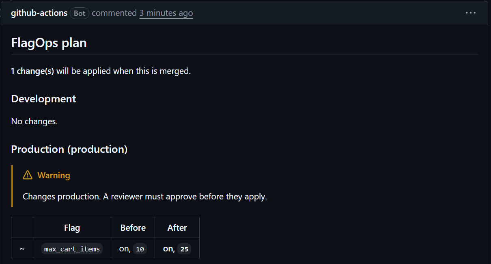

# FlagOps

[](https://github.com/Akash-016/flagops/actions/workflows/ci.yml)

**Manage Flagsmith flags like code: every change reviewed in a pull request, with alerts when someone changes production by hand.**

Built for the WeMakeDevs × Flagsmith hackathon, **Track 3: Build on Open Source Flagsmith**.



## The problem

On self-hosted Flagsmith, anyone with dashboard access can flip a production flag. There is no review step between a wrong click and your users, and no record in Git of what changed or why. Over time, flags pile up that nobody dares to delete.

## What FlagOps does

Your flags live in YAML files in a Git repo, one file per environment. FlagOps keeps Flagsmith and those files in step:

| | |
|---|---|
| **Plan on every pull request** | A bot comments with a table of what will change, in which environment, and where in your code each changed flag is used. |
| **Apply on merge** | Development and Staging update right away. Production waits until a named reviewer approves. |
| **Catch drift** | A scheduled check opens an issue when Flagsmith no longer matches Git (someone used the dashboard), and closes it once fixed. |
| **Find stale flags** | Lists flags with the same setting in every environment for 30+ days, with the code to clean up. |
| **Validate offline** | Checks the files without an API key, so it runs safely on every pull request, forks included. |
| **Never deletes** | Flags missing from YAML are reported, not removed. |

It ships as a CLI, a GitHub Action, and a one-command Docker setup.

## Quick start (5 minutes)

**1. Start self-hosted Flagsmith**

```bash
git clone https://github.com/Akash-016/flagops.git
cd flagops
docker compose up -d
```

Open http://localhost:8000, sign up, and create an organisation and a project.

**2. Create an Admin API key**

Organisation Settings → API Keys → Create. Put it in a `.env` file (never commit it):

```bash
FLAGSMITH_API_URL=http://localhost:8000/api/v1
FLAGSMITH_ADMIN_KEY=your-key
```

**3. Optional: load demo data** (3 environments, 7 sample flags)

```bash
npm install
npm run seed
```

**4. Export your flags to YAML**

```bash
npx github:Akash-016/flagops pull
```

This writes `flags/development.yaml`, `flags/staging.yaml` and `flags/production.yaml`. Edit one, then:

```bash
npx github:Akash-016/flagops plan     # what would change
npx github:Akash-016/flagops apply    # make the change (asks first)
```

**5. Add the GitHub Action** to the repo that holds your `flags/` folder

1. Copy the four files from [`examples/workflows/`](examples/workflows) to `.github/workflows/`.
2. Settings → Secrets and variables → Actions: add the secret `FLAGSMITH_ADMIN_KEY` and the variable `FLAGSMITH_API_URL`.
3. Settings → Environments → New environment `production` → Required reviewers → add who may approve production flag changes.
4. Make `validate` a required status check on `main`, so broken flag files can't be merged.
5. Read the [security model](#security-model) and protect `.github/workflows/`.

The examples use GitHub's `ubuntu-latest` runners, which need Flagsmith on an address they can reach. If Flagsmith runs on a private network, use a [self-hosted runner](https://docs.github.com/en/actions/hosting-your-own-runners) in a private repo. The [demo repo](https://github.com/Akash-016/flagops-demo) does this, with Flagsmith on the maintainer's machine.

## How FlagOps uses Flagsmith

FlagOps talks to the **Flagsmith Admin API** of a self-hosted instance, authenticated with an organisation API key (`Authorization: Api-Key ...`).

| Endpoint | Used by | For |
|---|---|---|
| `GET /projects/` | all | Find the project |
| `GET /environments/?project=<id>` | all | List environments and their keys |
| `GET /projects/<id>/features/` | all | Flag names, tags, archived state |
| `GET /environments/<key>/featurestates/` | pull, plan, drift, stale | Each flag's on/off, value and last change, per environment |
| `PATCH /environments/<key>/featurestates/<id>/` | apply | Change a flag's on/off and value |
| `POST /projects/<id>/features/` | apply | Create a flag that's new in YAML |
| `GET /projects/<id>/tags/` | stale | Skip flags tagged `permanent` |

Segment overrides and per-user (identity) overrides are left alone: FlagOps reads and writes only each environment's default flag state.

## Commands

| Command | What it does |
|---|---|
| `flagops validate` | Check the flag files without connecting to Flagsmith: schema, one file per environment, same flags in every file |
| `flagops check` | Test the connection and list projects |
| `flagops pull` | Write each environment's flags to `flags/<environment>.yaml` |
| `flagops plan` | Show what `apply` would change and where the changed flags are used in code |
| `flagops apply` | Make Flagsmith match the YAML. Asks first; `--yes` skips the question (CI) |
| `flagops drift` | Report differences between Flagsmith and YAML. Exit code 2 means drift |
| `flagops stale` | List flags with the same setting everywhere, unchanged for `--days` (default 30) |

Common options:

| Option | Meaning |
|---|---|
| `-p, --project <id or name>` | Pick the project if there are several |
| `-d, --dir <dir>` | Folder with the flag files (default `flags`) |
| `-e, --env <name>` | Only this environment; repeat for more |
| `-f, --format markdown` | Markdown output (used for PR comments and issues) |
| `--code <dir>` / `--no-code` | Where to search for flag usage, or don't search |

## YAML format

```yaml
environment: Production
flags:
  checkout_v2:
    enabled: false
    value: null
  max_cart_items:
    enabled: true
    value: 25
```

`value` can be text, a number, `true`/`false`, or `null`. A typo stops every command with the exact place, for example `flags.max_cart_items.enabled: expected boolean, received string`.

**Every file must list the same flags.** A Flagsmith flag always exists in every environment, so a new flag goes into each file (with `enabled: false` where it should stay off). If it's missing from one, every command stops and says which file to fix.

## GitHub Action

```yaml
- uses: Akash-016/flagops@v1
  with:
    command: plan            # validate, plan, apply or drift
    api-url: ${{ vars.FLAGSMITH_API_URL }}
    admin-key: ${{ secrets.FLAGSMITH_ADMIN_KEY }}
    # environments: Production      # optional, comma-separated
    # project: My Project           # optional
```

| Command | Result |
|---|---|
| `validate` | Checks the files offline. Needs no `api-url` or `admin-key` |
| `plan` | Posts (and keeps updating) one plan comment on the pull request |
| `apply` | Applies the YAML. Put production in a job with `environment: production` for approval |
| `drift` | Opens an issue on drift and closes it when Flagsmith matches Git again |

The Action is a prebuilt bundle (`dist/`), so it installs nothing and runs in seconds on Linux, macOS and Windows runners.

## Security model

FlagOps makes Git the record of every flag change, and makes production changes wait for a reviewer. Know where that protection ends:

- **The admin key can change any environment.** Flagsmith organisation API keys can't be limited to one environment, so the same key serves plan, apply and drift.
- **Anyone with write access to the repo can bypass the approval.** Pull request workflows from branches in the same repo can read repository secrets. A writer could edit the plan workflow inside a pull request to run `apply` on production. Close this gap:
  - Add a `CODEOWNERS` entry for `.github/workflows/` and turn on branch protection for `main` with "Require review from Code Owners", so workflow changes need a second person.
  - Give write access only to people you'd trust with the Flagsmith dashboard anyway.
- **Fork pull requests are safe.** GitHub gives them no secrets. The examples run only `validate` for forks and skip `plan`.
- **Drift is the backstop.** Any change that reaches Flagsmith outside a reviewed merge, from the dashboard or from a misused key, shows up in the next drift check as an issue.
- **Self-hosted runners only on private repos.** On a public repo, a pull request could run code on the runner's machine.

## Limits

- Only each environment's default flag state. Segment overrides, identity overrides and multivariate weights are not managed yet.
- `apply` never deletes flags. Flags removed from YAML are reported as "left alone".
- A new flag must be listed in every environment file, because Flagsmith creates each flag in every environment.
- Free Flagsmith organisations get one project; FlagOps works with one project per flags folder.
- `stale` uses Flagsmith's last-update time for each environment's flag state.

## Why not Terraform?

Flagsmith has an official Terraform provider, and it's a good choice if you already run Terraform. FlagOps aims at teams that don't:

- `flagops pull` writes YAML from the flags you already have. No import step, no state file to store and lock.
- The plan appears as a pull request comment with no extra tooling, and shows where each flag is used in your code.
- Drift detection and stale-flag reports are built in.

## Development

```bash
npm install
npm test           # unit tests (vitest)
                   # CI also runs a full round trip against Flagsmith in Docker: .github/workflows/ci.yml
npm run build      # type check + bundle to dist/
npm run dev -- plan   # run the CLI from source
```

## License

[MIT](LICENSE) © 2026 Akash V
